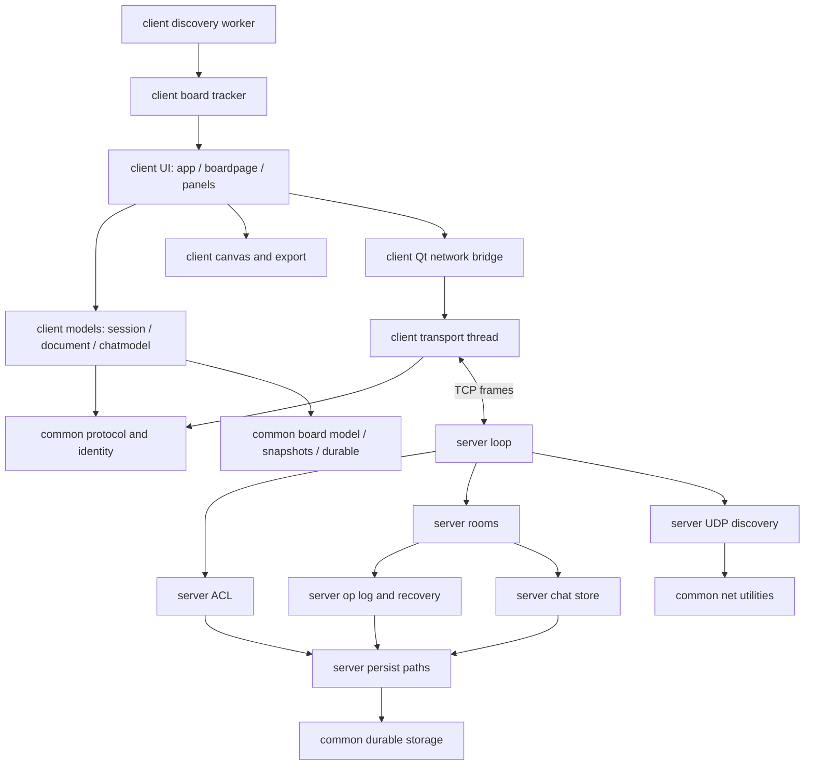

# LANvas Codebase and Runtime Report

This report describes the implementation currently in this repository. It is intended for a reader who is new to the project. Start with the overview, then follow the depth-first paths when you want to understand a feature from a button click to its network and disk effects.

> **Implementation note:** Some older design text describes TLS and encrypted/signed save files. Those are not present in the current Python implementation. The current TCP traffic is plaintext; Ed25519 authenticates client identity, while SHA-256 and CRC checks are used for fingerprints, deduplication keys, board consistency and file integrity. These mechanisms are explained separately below.

## 1. Overall view

### What LANvas does

LANvas is a desktop collaborative whiteboard for a local network. A user starts a server, creates a room, and opens one or more desktop clients. Clients discover servers over UDP or connect to an address, prove their identity, and then send board operations and chat messages over TCP. A server owns the canonical room state and durable history.

The board can contain frames, rectangles, ellipses, lines, arrows, freehand paths, text, sticky notes, images and groups. The client draws these objects using Qt's Graphics View framework. The client also supplies room chat, private messages, roles, access requests, invitations, checkpoints, undo/redo, recovery, discovery and PNG/JPEG/SVG/PDF export.

### Main architectural idea

The system uses **optimistic local editing with a central authoritative server**:

1. A user edits the local board. The client immediately applies the edit to a temporary visible view, so the interface feels responsive.
2. The client sends an operation with a unique `op_id` to the server.
3. The server checks identity, room membership, role, rate limits and operation schema.
4. The server assigns the next room sequence number (`seq`), writes the operation to its append-only log, applies it to its board, and broadcasts it.
5. Every client applies the broadcast in sequence order. A client's own pending operation is reconciled when its broadcast returns.

The server's single-threaded selector loop processes one message at a time. This gives each room one unambiguous operation order without a distributed consensus protocol. Clients independently run the same deterministic board operation code, so the same ordered operations produce the same state.

This is **not a CRDT implementation and not a full Operational Transformation implementation**. The server serializes accepted operations; it does not transform them based on concurrent edit context. Concurrent updates generally resolve by server sequence order, with per-property updates and tombstones defining the behavior.

### Runtime processes and threads

| Runtime component | Owns | Why it exists |
|---|---|---|
| Client Qt/UI thread | Widgets, `BoardPage`, canvas scene, user input, event handling | Qt widgets and scene updates stay on the GUI thread. |
| Client network thread | TCP socket, frame decoder, reconnect loop, packet inspector, simulated network faults | Socket waits must not block the UI. |
| Client discovery thread | Shared UDP discovery socket and announce parsing | Discovery continues while the UI is active and is independent of the TCP connection. |
| Client I/O worker | Client recovery journal writes | Disk writes are queued off the UI thread. |
| Server main thread | One selector loop, all TCP connections, room state, UDP discovery socket | Serial processing makes room sequence assignment simple and deterministic. |

### Repository map

```text
client/     Desktop application, models, canvas, panels, networking and local recovery
common/     Protocol, data model, identity, hashing, durable file operations and shared validation
server/     Authoritative room server, access control, chat, persistence and discovery
tests/      Unit, component, integration, security, UI, performance and fault tests
scripts/    Lint/test gate, requirement gate and documentation generation
build/      PyInstaller entry points and build orchestration
docs/       User guide, test record, screenshots and design documents
```

The key dependency rule is: `common/` is shared by client and server; the client imports `common/` but not `server/`; the server imports `common/`; UI-specific code lives under `client/` and may use PyQt6.

## 2. File-by-file use case

The entries below cover the Python modules present in the current source tree. “Functions” names the public or important internal operations; ordinary Qt event handlers and small private helpers are grouped by the behavior they implement.

### `client/`

| File | Use case and important behavior |
|---|---|
| `client/main.py` | Process entry point. Parses profile, theme, UDP port, verbosity and smoke-test options; configures logs; constructs `QApplication`; loads fonts/theme; launches smoke mode or `AppWindow`. |
| `client/app.py` | Top-level navigation and lifecycle. `AppWindow` owns launcher, access-request screen, current `Session`, `NetWorker`, `BoardPage`, identity, settings and crash-recovery candidates. `join_board`, `join_by_address`, `create_room`, and `connect_to` prepare room intent and start a connection. Network/session callbacks switch screens, handle approval, reconnect, leave, recover or return to launcher. |
| `client/launcher.py` | Main landing page, discovered-room list, server selection, username, create/join controls and recovery banner. `BoardRow` renders a discovered board and forwards user selection. |
| `client/request_screen.py` | Waiting/denied/connecting screen while a join is being negotiated. Shows target room/server and the user's short fingerprint for identity comparison; emits retry/cancel signals. |
| `client/dialogs.py` | Modal UI flows: join by address, create room, approve/deny a request, choose recovery action, choose export settings, browse/restore checkpoint history, and choose a private-message recipient. `_ok_cancel` applies the common dialog button pattern. |
| `client/boardpage.py` | Main in-room screen. Connects session events to canvas, chat, panels, presence, status, save UI, exports and owner actions. `Exporter` advances the incremental export generator and writes finished bytes. `BoardPage._run_export` selects the requested output adapter and scope. |
| `client/widgets.py` | Reused Qt widgets and helpers: toast hosting, color buttons, avatars, fields, labels and status/spinner components. Keeps common visual behavior out of each page. |
| `client/theme.py` | Palette, spacing, fonts, design tokens, light/dark styling and deterministic identity color selection. `load_fonts` registers bundled Inter fonts; `apply` sets application styling. |
| `client/icons.py` | Small bundled SVG icon data and Qt conversion helpers (`svg`, `pixmap`, `icon`). No network lookup is required to display icons. |
| `client/paths.py` | Platform-specific user data directory. `set_profile` selects a sanitized profile; `app_dir`, `identity_file`, `settings_file`, and `journal_dir` centralize local paths. `LANVAS_HOME` can override the base directory. |
| `client/boardlist.py` | Qt-free discovery data model. `parse_announce` validates untrusted UDP JSON; `BoardTracker.feed` records rooms/servers, filters flood traffic, determines version compatibility and updates expiry; `boards`, `servers`, and `expire` provide sorted views. |
| `client/discovery.py` | Qt worker that binds the shared UDP discovery port, sends `LANVAS_DISCOVER`, receives announces, invokes `BoardTracker`, expires old entries and emits changed board/server lists. `refresh` requests an immediate query; `stop` shuts the worker down. |
| `client/transport.py` | Qt-free TCP engine. `NetCore` owns one logical room connection across reconnects, frames messages, sends the identity proof, dispatches incoming frames, pings, tracks RTT, buffers/retries and optionally simulates latency/duplication/reordering/drop. `Inspector` stores a bounded packet ring; `scrub_private` masks third-party DM text. |
| `client/net.py` | Thin Qt bridge. `NetWorker` wraps `NetCore` and delivers events to Qt using queued signals, so networking threads never directly mutate widgets. |
| `client/session.py` | Headless state coordinator for one room. Routes server frames into `Document` and `ChatModel`, creates operation/message IDs, journals pending work, resends safely after reconnect, sends access/admin/save/history commands, checks checkpoint hashes and emits UI events. |
| `client/document.py` | Local board state, optimistic edits and collaboration undo/redo. Maintains confirmed state plus visible state plus pending operations. `create`, `update`, `delete`, `clear`, `restore`, `replace_board`, `undo`, `redo`, `receive`, `on_ack`, `on_reject` and `hash` are the central API. `UndoStep` tracks one user action; `UndoResult` reports generated inverse operations and conflicts. |
| `client/chatmodel.py` | In-memory client chat state. `ChatChannel` inserts messages in sequence order, deduplicates and detects sequence gaps. `ChatModel` manages room/DM channels, unread markers, history pages, composing, acknowledgements, retries and outgoing message IDs. |
| `client/recovery.py` | Crash journal and background disk worker. `Journal` stores metadata, lock, confirmed-board snapshots and add/done events for pending operations/chat. `find_crashed` checks whether lock-file PIDs remain alive, reads the last valid snapshot and reconstructs unacknowledged work. `discard_crashed` removes the selected journal. |
| `client/smoke.py` | Packaged-client self-check. Creates a temporary board, exercises connect/draw/chat/save and each export format against a running server, then verifies output artifacts. It is invoked by `client.main --smoke`. |
| `client/__init__.py` | Marks `client` as a Python package. |

### `client/canvas/`

| File | Use case and important behavior |
|---|---|
| `client/canvas/items.py` | Qt graphics item for one board object. `BoardItem.sync` refreshes it from validated model data; `paint` dispatches to shape-specific painters for frame, rectangle, ellipse, line, arrow, path, text, sticky note, image and group. Geometry helpers convert model coordinates and colors to Qt values. |
| `client/canvas/scene.py` | Owns the `QGraphicsScene` object index. `sync` creates, updates and removes graphics items based on changed IDs; z-order and frame clipping mirror model state. `item_at` and `content_rect` support selection and viewport behavior. |
| `client/canvas/view.py` | Interactive `QGraphicsView`. Handles zoom/pan, selection, grouping, alignment, keyboard actions, text editor overlays, transient cursor/presence rendering and scene synchronization. It delegates pointer gestures to tool objects in `tools.py`. |
| `client/canvas/tools.py` | Tool state machines: selection/move/resize/rotate, hand/pan, freehand pen, whole-stroke eraser, shape, line/arrow, text and sticky creation. Tools translate mouse gestures into document/session operations and draw temporary previews. `simplify` reduces freehand point count before commit. |
| `client/canvas/__init__.py` | Marks the canvas folder as a package. |

### `client/export/`

| File | Use case and important behavior |
|---|---|
| `client/export/renderer.py` | Shared export semantics. `Scope` describes whole-board, selection or frame output; `collect_items` filters invisible/non-exportable objects and descendants; `bounds_of` computes output bounds; `paint_items` incrementally paints and yields progress counts; `drive` is used by tests/smoke mode to consume a generator. |
| `client/export/formats.py` | Format adapters. `export_raster` emits PNG/JPEG through `QImage`; `raster_size` estimates pixels; `export_svg` emits vector SVG; `export_pdf` emits fit/A4/A3 pages, optionally one page per frame. Each adapter uses the shared renderer rather than implementing object painting again. |
| `client/export/__init__.py` | Marks export folder as a package. |

### `client/panels/`

| File | Use case and important behavior |
|---|---|
| `client/panels/chat.py` | Room/DM chat UI: channel list, messages, unread state, history paging, send/retry, link handling, retention settings and owner chat controls. Rendering escapes content before presenting it as rich text. |
| `client/panels/design.py` | Properties panel for selected objects. Reads common values across selection and emits validated property updates for fill, stroke, dimensions, opacity, typography and related design controls. |
| `client/panels/inspector.py` | Developer/diagnostic UI: packet/session detail, discovered servers and network chaos controls. It is primarily for observing and testing behavior. |
| `client/panels/layers.py` | Hierarchical layer view backed by model parent relationships and fractional z-order. Selection, rename, visibility/lock and drag-reorder update the board model. |
| `client/panels/sharing.py` | Combines member list/popover and owner share/access dialog. Shows members and roles, offers private-message entry, role/mute/kick controls, room code/address, pending requests, room settings, invites, revoke and member removal. Server remains responsible for authorization. |
| `client/panels/__init__.py` | Marks panels folder as a package. |

### `common/`

| File | Use case and important functions |
|---|---|
| `common/protocol.py` | Wire constants, message IDs, error IDs, JSON payload conversion and TCP frame codec. `encode_frame` emits `LV` header + UTF-8 JSON and optional zlib compression; `FrameDecoder.feed` incrementally reconstructs messages and checks size, version, flags, decompression bounds, JSON depth and payload shape. |
| `common/model.py` | Authoritative object schema and deterministic reducer. `validate_props`, `validate_object`, `validate_op` reject invalid client data; `Board` stores live objects and tombstones; `apply_op` applies accepted create/update/delete/clear/restore/bulk-create operations identically on server and client. |
| `common/fractional.py` | Fractional index strings for layer ordering. `between` allocates a key between neighbors; `spaced_keys` rebuilds short keys; `needs_rebalance` detects excessive growth. |
| `common/identity.py` | Ed25519 identity persistence, public-key fingerprinting, base64 helpers, proof signing and verification. `Identity.load_or_create` persists the raw private key with restrictive permissions where supported. |
| `common/chat.py` | Shared chat schema constants and validation. `dm_channel_id` derives a stable per-pair channel ID; `clean_text` strips controls; `validate_outgoing` validates sender payload; `validate_retention` validates the room chat-retention policy. |
| `common/durable.py` | Shared atomic and append-only file operations. `atomic_write` uses a temp file, fsync, atomic replace and optional `.bak`; `AppendLog` writes CRC-protected sequence lines and group-syncs; `scan_log` stops at the first invalid/torn line; `truncate_log` repairs it; `rewrite_log` atomically rewrites retained history. Fault hooks exist for crash tests. |
| `common/snapshot.py` | Canonical JSON, board hashes and compressed verified snapshots. `canonical_json` fixes key ordering/spacing; `board_hash` uses SHA-256; `encode_snapshot` writes gzip; `decode_snapshot` bounds decompression and verifies metadata/hash before accepting a board. |
| `common/netutil.py` | IPv4 interface and broadcast helpers. Uses Linux ioctl when available, falls back to hostname/route selection elsewhere, provides broadcast targets and opens the reusable UDP discovery socket. |
| `common/simplify.py` | Iterative Ramer–Douglas–Peucker path simplification. `_segment_distance_sq` measures point distance; `simplify` keeps essential stroke points while controlling geometric error. |
| `common/logging_setup.py` | Configures stderr and rotating UTF-8 file handlers; bounds log size to 5 MB with three backups. Used by client/server entry points. |
| `common/__init__.py` | Marks shared code as a package. |

### `server/`

| File | Use case and important behavior |
|---|---|
| `server/main.py` | Parses server address/port/data/discovery/verbosity flags; configures logs; constructs and starts `Server`; prints startup/listening/shutdown information and handles OS stop signals. |
| `server/loop.py` | TCP server and state machine. `Server.start/run/poll/_tick` own lifecycle; `adopt/_read/_dispatch/_send/_flush` handle nonblocking connections; handshake methods validate identity; `_on_op`, `_on_chat`, `_on_save`, `_on_resync` implement operations; `_on_access_decision` and `_admin_*` enforce owner controls; presence and broadcast methods fan out server events. |
| `server/rooms.py` | One in-memory room aggregate. `Room.create/load` initialize/recover; `apply_and_log` sequences, durably records and applies ops; `ops_since` serves a delta while it remains in the replay window; `maybe_snapshot`, `sync` and `close` delegate durable work. Room also owns ACL, chat store, operation log and live connection set. |
| `server/acl.py` | Role permission matrix and persisted room membership. `can` is the central deny-by-default permission check. `Acl` manages owner, members, requests, denies, blocks, mute, settings and invites. `TokenBucket` limits per-connection traffic; `IpRequestLimiter` throttles new access requests by IP. |
| `server/chatstore.py` | Durable room and DM channels. `Channel` loads, pages and appends its sequence-ordered message log. `ChatStore` routes by stable DM channel, deduplicates IDs, checks channel readership, stores read positions/unread totals, clears room chat and applies retention. |
| `server/oplog.py` | Operation history, snapshots/checkpoints and server recovery. `OpLog.append/write_snapshot/write_checkpoint` persists canonical state; `load_checkpoint/delete_checkpoint` manage version history. `recover_board` selects a verified snapshot and replays valid later operations; `write_recovery_log` records repair summaries. |
| `server/persist.py` | Room disk layout contract (`RoomPaths`) and server-facing time/durable helper exports. It defines paths for room metadata, ACL, ops, chat, DMs, snapshots, checkpoints and recovery notes so callers do not construct those paths independently. |
| `server/discovery.py` | UDP server announcements and replies. `pages` builds size-bounded paginated announcements; `announce/tick` broadcast them; `_handle` responds to bounded discover requests with rate limits; `discoverable_rooms` data comes from the server. |
| `server/__init__.py` | Marks server code as a package. |

### `tests/`, `scripts/`, `build/` and non-Python files

| File/group | Use case |
|---|---|
| `tests/conftest.py` | Shared pytest options, deterministic random seeds and offscreen Qt application fixture. |
| `tests/harness.py` | Reusable real-socket bot client, fake clock, discovery probe, server thread and fault-injection helpers for integration tests. |
| `tests/test_acl.py` | Permission matrix, membership state, approval, denial, cooldown, invites, abuse limits and security cases. |
| `tests/test_chat.py` | Chat validation, DM privacy/routing, deduplication, paging, read/unread, retention and restart persistence. |
| `tests/test_client_logic.py` | Client document/session collaboration, undo, optimistic reconciliation, outbox and crash recovery. |
| `tests/test_discovery.py` | UDP discovery packet shape, versioning, expiry, pagination, rate limits and room lifecycle. |
| `tests/test_durable.py` | Atomic-write crash points, CRC/torn log behavior, ordering and group commit. |
| `tests/test_framing.py` | Partial/multiple TCP frames, limits, compression, malformed JSON, nesting and fuzz safety. |
| `tests/test_model.py` | Board validation/reducer, object limits, deterministic replay, fractional keys and identity proof properties. |
| `tests/test_perf.py` | Latency, persistence throughput, 1,000-object load, drawing responsiveness and idle server CPU targets. |
| `tests/test_process.py` | Subprocess/server startup, process-kill recovery and packaged executable flow. |
| `tests/test_server_core.py` | Multi-client convergence, ordering, replay/resync, persistence/restart and hostile frames. |
| `tests/test_ui.py` | Offscreen UI, canvas gestures, panels, access flows, export formats, recovery and full user paths. |
| `scripts/check.py` | Fast local gate: Ruff plus all tests excluding perf, LAN-only and chaos soak markers. |
| `scripts/gate.py` | Runs requirement-tagged tests and produces a gate/test report. |
| `scripts/make_pdf.py` | Generates the technical documentation PDF from repository documentation. |
| `build/make.py` | PyInstaller packaging orchestration for the client and server. |
| `build/entry_client.py`, `build/entry_server.py` | Separate packaging entry points so the GUI client and console server remain distinct. |
| `requirements.txt`, `pyproject.toml`, `uv.lock` | Pinned runtime/dev dependencies, lint/test settings and lockfile. |
| `README.md`, `Architecture.md`, `Design.md`, `ProductContext.md`, `Agents.md` | Product description, design intent, architecture, UI behavior and development process. Some legacy crypto/TLS prose is aspirational and must be read against implementation; see the security section below. |
| `docs/USER_GUIDE.md`, `docs/test-log.md`, `docs/screenshots/`, PDF | User instructions, test evidence, screenshots and generated technical reference. |
| `client/assets/fonts/` | Bundled Inter font and license used by the UI and text rendering. |

### Function navigation for the main code paths

This reference gives the intended reading order for the functions that form the main behavior. Small paint/Qt event overrides are grouped by their effect; their implementation remains in the module named in the first column.

| Module | Function groups and what each group does |
|---|---|
| `client/app.py` | `_load_settings`/`_name_changed` read and persist local preferences. Discovery callbacks update launcher data. `join_board`/`join_by_address`/`create_room` build room intent. `connect_to` creates session/network/UI objects. `_on_net_event` and `_on_session_event` route callbacks. `_entered_room`/`_back_to_launcher` switch UI state. `_reconnect_same`, `leave`, `recover`, `_discard` handle reconnect, clean leave and crash recovery. `closeEvent` shuts down workers. |
| `client/transport.py` | `NetCore.send` queues encoded frames and wakes the socket loop. `_run` reconnects with backoff. `_session` owns one TCP attempt and heartbeat. `_on_frame` completes proof handshake and recognizes pending/welcome/fatal states. `_deliver`/`_schedule` simulate delivery faults. `Inspector.record/snapshot` stores redacted bounded packet history. |
| `client/session.py` | `hello_fields` names room and resume sequence. `handle_frame` maps server packet IDs to `_on_*` handlers. `_on_welcome` initializes room/document/chat/journal; `_on_op`, `_on_op_ack`, `_on_op_reject`, `_on_resync`, `_on_snapshot` synchronize board; `create/update/delete/clear/restore/replace_board` submit changes; `send_chat`, `_on_chat*`, `load_older`, `open_channel` manage messages/history/read state; `send_admin`, `decide_access`, `save`, `_on_save*`, `_check_save_hash` cover management and checkpoints; `tick/close` run periodic persistence/retry and shutdown. |
| `client/document.py` | `next_op_id/new_object_id/top_z` allocate identifiers/order; `create/update/delete/clear/restore/replace_board` mutate visible state and push undo records; `_travel*`, `undo`, `redo` construct inverse operations while detecting conflicting remote edits; `load_snapshot/receive/_apply_confirmed` adopt sequence-ordered server state; `_rebuild_view` reapplies pending local changes; `on_ack/on_reject` settle or roll back; `hash` hashes confirmed state only. |
| `client/chatmodel.py` | `load_welcome/ensure_dm` build channel state; `receive/insert` sequence and deduplicate inbound messages; `compose/on_ack/on_reject/retry` manage outgoing messages; `merge_history/history_request/gap_request` fill older pages or missing sequence ranges; `mark_active` changes channel/read marker. |
| `client/canvas/view.py`, `tools.py` | `CanvasView` selection/group/zoom/edit methods translate state and view operations; Qt mouse/key events call the current `Tool`. Tool `press/move/release` methods implement gesture state; specialized methods create/preview/move/resize/erase objects. `BoardItem.paint` renders the model values; `BoardScene.sync` maps changed IDs back to graphics items. |
| `server/loop.py` | `start/_load_rooms/run/poll/_tick/_shutdown` lifecycle and timers; `adopt/_on_accept/_read/_dispatch/_send/_flush/_drop` socket plumbing; `_on_hello/_on_proof/_admit/_activate/_welcome` handshake and admission; `_on_op/_op_permission/_reject_op` validate and sequence board changes; `_on_transient` forwards ephemeral updates; `_on_resync` returns delta/snapshot; `_on_chat/_on_chat_history/_on_chat_read` manage messages; `_on_save` checkpoints; `_on_access_decision/_on_admin/_admin_*` perform owner-controlled ACL and room changes; `_broadcast/_presence/_member_event` distribute events. |
| `server/rooms.py`, `server/oplog.py` | `Room.create/load` initializes or reconstructs a room. `apply_and_log` assigns server sequence, appends, applies, updates replay/dedupe. `ops_since` checks delta availability. `OpLog.write_snapshot/write_checkpoint` persists point-in-time state. `recover_board` picks the newest verified snapshot, then replays good log entries beyond its sequence. |
| `server/acl.py` | `can` is the permission decision. `Acl.load/save` restore and persist. `set_owner/add_member/role_of` manage membership. `record_request/pending_requests/deny/cooldown_left` implement request lifecycle. `create_invite/consume_invite` implement invite lifecycle. `TokenBucket.allow` and `IpRequestLimiter.allow` implement rate controls. |
| `server/chatstore.py` | `Channel.load/page` restore and read history. `ChatStore.load/append/duplicate_seq` restore, sequence and deduplicate. `channel_for_reader` authorizes history visibility. `mark_read/unread/dm_index` maintain user read state. `clear_room/prune` apply owner retention controls. |
| `common/protocol.py`, `common/model.py` | `encode_frame/FrameDecoder.feed` are the only TCP message codec path. `validate_op` is the server input gate; `apply_op` is the shared deterministic reducer. The lower-level `_num`, `_points`, `validate_props`, `validate_object` functions encode the board schema limits. |

## 3. Depth-first data flow and navigation report

### A. Starting the server

1. `python -m server.main` enters `server.main.main`.
2. CLI options select bind host, TCP port (47801 by default), UDP port (47800), data root and discovery behavior.
3. `configure_logging` attaches stderr and rotating file logging under `<data>/logs/lanvas.log`.
4. `Server.start` loads room directories before opening the TCP listener. Each directory is passed to `Room.load`.
5. `Room.load` reads room metadata and ACL with `.bak` fallback, restores the board through `server.oplog.recover_board`, loads room/DM chat logs, applies retention and writes a recovery summary.
6. The server loads or generates `server.json` identity, binds its nonblocking TCP listener and registers it with `selectors.DefaultSelector`.
7. If discovery is enabled, `Discovery` opens UDP 47800 and is registered with the same selector. The event loop then calls `poll`, dispatches readiness and executes `_tick` for timers, syncs, snapshots and timeouts.

### B. Starting the desktop client and discovering rooms

1. `python -m client.main` parses command-line options and selects an optional profile path.
2. It configures the client log in the user data directory, creates `QApplication`, loads bundled fonts and applies `client.theme`.
3. `AppWindow` loads the persistent Ed25519 identity, username/settings and any crash-recovery candidates.
4. `AppWindow` starts `DiscoveryWorker`; the worker sends a small `LANVAS_DISCOVER` UDP JSON datagram and listens for `LANVAS_ANNOUNCE` replies/broadcasts.
5. `client.boardlist.parse_announce` validates each untrusted datagram. `BoardTracker.feed` keys boards by `(server_id, room_id)`, marks protocol compatibility, prevents one source from flooding the list, and expires entries after seven seconds without an announce.
6. The worker emits a changed list. `AppWindow._boards_changed` updates `LauncherPage` and (if already in a room) the board switch menu.

### C. Joining or creating a room

1. A launcher selection calls `AppWindow.join_board`; manual address uses `JoinByAddressDialog`; room creation uses `CreateRoomDialog`.
2. The client builds the initial `HELLO` fields (room ID, room code, invite, or create request) and calls `AppWindow.connect_to`.
3. `connect_to` creates a `Session`, creates `NetWorker`/`NetCore`, and constructs the future `BoardPage`. The board page is not shown as admitted until a successful `WELCOME` arrives.
4. `NetCore` runs on a background thread. It opens TCP, encodes `HELLO` with username, base64 public key, protocol version and room intent, then incrementally decodes server frames.
5. Server `Connection` begins in `CONNECTED`. `_dispatch` requires `HELLO`, validates the public key/name, generates a fresh 32-byte nonce and sends `CHALLENGE`.
6. Client responds with an Ed25519 signature over `LANVAS-PROOF-v2:` plus the nonce. The server verifies it and derives the fingerprint from the verified public key.
7. The server handles a create request, known member, valid invite, existing pending request, hidden/code-protected room, or new access request. Unknown users become `PENDING` and do not receive board state or chat.
8. For approval or an existing member/invite, `_activate` assigns the role and sends `WELCOME` with board snapshot or delta, member list, chat tail, DM summaries, room settings, checkpoint info and (for owners) pending requests.
9. `NetCore` transitions to `LIVE`; `Session.handle_frame` processes `WELCOME`; `Document` loads the board and applies any outstanding local work; `ChatModel` loads retained chat; the UI switches to `BoardPage`.

### D. One drawing operation, from gesture to every screen

1. `CanvasView` receives mouse/keyboard events and forwards the gesture to its active tool (`SelectTool`, `PenTool`, etc.).
2. A tool computes changed object properties or a new object. For a stroke it simplifies point data and commits one `path` creation rather than sending every mouse move as a durable operation.
3. The tool calls `Document`/`Session`. `Document._send_local` assigns `client_id:counter` as `op_id`, sets `base_seq`, appends to `pending`, applies immediately to `view`, and records undo metadata.
4. `Session._submit` journals the pending operation if crash recovery is active and sends `MsgType.OP` via `NetWorker` to `NetCore`.
5. The network thread serializes a TCP frame. The server's decoder ensures complete, bounded JSON before dispatch.
6. In `State.ACTIVE`, `_on_op` checks ID shape, permissions/locked state, duplicate operation ID, rate bucket and `common.model.validate_op`.
7. The server copies only whitelisted client fields. It supplies trusted `author` and `author_name`, expands checkpoint restore if needed, and calls `Room.apply_and_log`.
8. `Room.apply_and_log` assigns `seq = prior + 1`, writes the CRC-protected operation log first, then updates the server board and replay/dedupe tables.
9. Server returns `OP_ACK` to the sender and broadcasts sequenced `OP` to active room clients.
10. Each client removes its own matching pending op, applies each next contiguous sequence to `confirmed`, and replays remaining local pending ops over `view`. A sequence gap triggers `RESYNC`.
11. `BoardPage` handles the session's changed object IDs; `BoardScene.sync` updates only those `BoardItem`s and Qt repaints them.

### E. Chat and private-message flow

1. `ChatPanel` collects text and active channel. `ChatModel.compose` creates a client message ID, payload and outbox record.
2. `Session.send_chat` appends a journal add event, sends `CHAT` and updates UI optimistically.
3. The server rejects muted senders, invalid channel/text/ID, invalid/non-member/self DM recipient, duplicate or rate-limited messages.
4. `ChatStore.append` selects the room or stable DM channel, assigns channel-local `chat_seq`, stamps server UTC time and appends a CRC log line before making the message visible in memory.
5. `CHAT_ACK` confirms the ID and sequence. Room chat is broadcast to active room members. DMs are sent only to live connections whose verified fingerprints match sender or recipient.
6. Client receives `CHAT`, inserts by `chat_seq` (duplicate sequences are ignored), clears matching outbox state, requests history if a sequence gap exists and sends `CHAT_READ` when the active channel is read.
7. For reconnect/history, `WELCOME` includes a room tail and DM summaries; older pages use `CHAT_HISTORY`. Server checks channel membership before reading a DM page.

### F. Save, checkpoint, restart and recovery flow

1. Ctrl+S invokes `Session.save`. Owner/editor roles may send `SAVE`; viewers receive a UI explanation and cannot request a checkpoint.
2. Server flushes/fsyncs room logs, writes a gzip snapshot checkpoint and atomically updates the checkpoint index. `SAVE_ACK` includes checkpoint ID, sequence and board hash.
3. The client compares the checkpoint hash with its own confirmed board once it reaches that sequence. A mismatch requests a full snapshot.
4. Automatic snapshots are periodic/per-operation accelerators. The append-only op log remains the replay source of truth.
5. On server restart, `Room.load` chooses the newest verified snapshot/checkpoint, replays CRC-valid later operations and truncates a torn log tail. ACL/metadata can fall back to `.bak`.
6. On client crash, the session lock remains. Next startup checks PID liveness, loads the last confirmed journal snapshot and replays pending add/done records. User can rejoin and resend; server-side `op_id`/`msg_id` dedupe avoids applying already accepted work twice.

### G. Export flow

1. User chooses output format, scope, scale/background/page settings in `ExportDialog`.
2. `BoardPage` converts scope to a `renderer.Scope`, creates `BoardScene`/selection data and calls the matching adapter in `client.export.formats`.
3. Adapter obtains renderable items and bounds from `renderer.py`, invokes `paint_items` incrementally, and encodes using `QImage`, `QSvgGenerator` or `QPdfWriter`.
4. `Exporter` consumes progress yields, shows progress and writes final bytes to the selected path. Export is local; it does not send the board to the server.

## 4. How modules interact

### Dependency direction



### Ownership boundaries

- **`common.model` owns board meaning:** accepted operations have one deterministic interpretation, not separate client/server versions.
- **`server.loop` owns network admission and sequencing:** it decides which handlers are legal in each connection state and assigns sequence numbers.
- **`server.acl` owns permission decisions:** UI button states are convenience only; server checks every state-changing request.
- **`server.rooms` owns room aggregate state:** board, sequence, active connections, ACL, chat and op-log references stay associated by room.
- **`client.session` owns the client session glue:** network packets become document/chat mutations and UI events here.
- **`client.document` owns visible/confirmed board state:** Qt scene is a rendering of this model, not the canonical data store.
- **`common.durable` owns write guarantees:** both sides reuse the same low-level atomic/append helpers, though client and server use separate file layouts.
- **Qt bridge boundaries protect thread affinity:** worker threads emit data; Qt widgets are changed through queued signals on the UI thread.

### TCP versus UDP

TCP is used for the authenticated room session because board operations, chat, history and administration require ordered/reliable delivery. The application still frames TCP itself because TCP delivers a byte stream, not messages. UDP is reserved for discovery: datagrams are small, periodic, lossy and useful before the client knows a server address. Discovery announces contain public room-list metadata only, not room codes, ACL member lists, board content or chat.

## 5. Every network packet and call

All TCP packet types are JSON objects inside the binary frame described below. The integer packet ID is `MsgType` in `common/protocol.py`. **C→S** means client to server; **S→C** means server to client. The same packet type can have different request/reply roles as noted.

### TCP frame envelope

```text
"LV" (2 bytes) | protocol version (1) | type (1) | flags (1) | body length (4, big-endian) | body
```

The body is compact UTF-8 JSON. Payloads larger than 1 KiB are zlib-compressed only when compression shrinks them. The header length is validated before waiting for the full body. Client→server frames are capped at 8 MiB after frame encoding, pre-auth frames at 64 KiB, decompression at 64 MiB; server can send a frame up to 64 MiB for large snapshots. JSON depth is limited to 32. Compression is not encryption.

### TCP packet catalogue

| ID / name | Direction | Content and purpose | Server/client use |
|---|---|---|---|
| 1 `HELLO` | C→S | `{username, pubkey, protocol_version, ...intent}`. Intent may include `room_id`, `room_code`, `create:{name,code,discoverable,require_code,...}`, `invite`, `last_seq`. `pubkey` is base64 raw Ed25519 public key. | Starts a connection; server validates basic fields and issues a nonce. Client resends room ID and latest sequence after the first welcome/reconnect. |
| 2 `CHALLENGE` | S→C | `{nonce, protocol_version}` where `nonce` is base64 32 random bytes. | Proves the server received this connection's HELLO and gives the client a fresh challenge. |
| 3 `PROOF` | C→S | `{signature}`: base64 Ed25519 signature of domain prefix plus nonce. | Server verifies proof against HELLO public key; otherwise fatal `AUTH_FAILED`. |
| 4 `ACCESS_PENDING` | S→C | `{room_name, host_name, fingerprint}`. | Tells an unapproved user the request is pending. It deliberately contains no board/chat/member state. |
| 5 `ACCESS_REQUEST` | S→owner | `{fingerprint, name, ip, time}`. | Notifies active owner connections about a new request. Owner UI can approve, deny or block. |
| 6 `ACCESS_DECISION` | C→S | `{fingerprint, decision:"approve"|"deny"|"block", role?:"editor"|"viewer"}`. | Owner response to a pending request; server checks admin permission and transitions pending sockets or denies them. |
| 7 `WELCOME` | S→C | `{role, client_id, fingerprint, last_seq, room, members, chat_tail, room_chat_seq, room_read, dm_index, muted, settings, last_checkpoint, snapshot? | delta?, pending_requests?}`. | Admission and initial sync. Owners alone receive pending requests. If requested sequence is in replay window server sends delta; otherwise full board snapshot. |
| 8 `OP` | C→S operation; S→C accepted operation | Operation fields include `op_id`, `base_seq`, `kind` and kind-specific object fields. Server broadcast adds `seq`, `author`, `author_name`; client cannot set these trusted fields. | Client proposes a board mutation; server validates, sequences, persists and broadcasts accepted operation. |
| 9 `OP_ACK` | S→C | `{op_id, seq, duplicate?:true}`. | Confirms operation acceptance and its server sequence. Duplicate indicates server already accepted this ID. |
| 10 `OP_REJECT` | S→C | `{op_id, code}`. | Declines an operation; client removes optimistic pending effect and updates undo stack. |
| 11 `TRANSIENT` | C↔S | Client sends `{k, d}`. Server forwards `{from, client_id, name, k, d}`. | Ephemeral cursor, selection and live drawing previews. Rate-limited, size-bounded, not logged; can be dropped under load. |
| 12 `CHAT` | C→S message; S→C accepted message | Client `{msg_id, channel:"room"|"dm", to?:fingerprint, text, reply_to?}`. Server adds `{channel_id, chat_seq, from_fp, from_name, ts}` and DM `to_fp`. | Server validates, deduplicates, persists and broadcasts room messages or routes DM only to sender/recipient fingerprints. |
| 13 `CHAT_ACK` | S→C | `{msg_id, channel_id, chat_seq, ts, duplicate?:true}`. | Confirms accepted or previously accepted message so local outbox can settle. |
| 14 `CHAT_REJECT` | S→C | `{msg_id?, channel_id?, code}`. | Reports invalid channel/text, mute, flood or denied history read. Client marks a message failed except temporary rate limit, which is retried. |
| 15 `CHAT_HISTORY` | C→S request; S→C reply | Request `{channel_id, before_chat_seq?, limit}`. Reply `{channel_id, messages, has_more}`. | Supports initial DM fetch, older-page loading and gap repair. Server checks the requesting fingerprint can read the channel. |
| 16 `CHAT_READ` | C→S | `{channel_id, chat_seq}`. | Advances per-member read position; server clamps to current channel sequence and persists it. |
| 17 `PRESENCE` | S→C | Common fields `{event, fp, name, role?, muted?, client_id?}`. Room-setting event includes `{room, settings}`; member removal includes target fields; chat-cleared event has event only. | Announces join/leave/away/back, role/mute/member changes, room changes and cleared room chat. |
| 18 `RESYNC` | C→S request; S→C delta reply | Request `{from_seq}`. Reply `{ops, seq}`. | Request missed board operations. If the server no longer retains the needed contiguous history, it uses `SNAPSHOT` instead. |
| 19 `SNAPSHOT` | S→C | `{seq, board, board_hash}`. | Replaces confirmed client state when reconnect/resync cannot use an operation delta. |
| 20 `SAVE` | C→S | `{label?}`. | Requests a durable checkpoint. Only owner/editor can save; save is rate limited. |
| 21 `SAVE_ACK` | S→C | Checkpoint record: `{checkpoint_id, seq, board_hash, saved_by, label, time}`. | Confirms durable checkpoint; client compares hash at matching sequence. |
| 22 `SAVE_REJECT` | S→C | `{code}`. | Reports not allowed, rate limited or disk write failure. |
| 23 `ADMIN` | C→S action; S→C result | Request `{action, ...fields}`. Actions: `set_role{fp,role}`, `kick{fp}`, `revoke{fp}`, `mute{fp,muted}`, `set_settings{settings}`, `rename{name}`, `clear_chat`, `set_retention{policy}`, `create_invite{role,ttl,single_use?}`, `list_checkpoints`, `delete_checkpoint{checkpoint_id}`, `delete_room`. Reply `{action,ok:true,...}`; failures use `ERROR`. | Owner room administration. Every action is checked server-side. Invite reply includes raw token once; only its hash is retained on disk. |
| 24 `PING` | C↔S | `{t}` monotonic timestamp. | Keepalive and liveness; allowed while pending. |
| 25 `PONG` | S↔C | Echoes `{t}`. | Client computes RTT; server uses it as liveness. |
| 26 `ERROR` | S→C | `{code, message?, fatal?, retry_after?, action?}`. | General protocol/state/admission/admin error. Fatal errors close after flushing; recoverable errors leave connection alive. |

The important `ErrorCode` values include malformed frame/version/schema/state, identity/access denied, room/code missing, role denied/locked, request rate limit, connection/timeout, kicked/revoked/muted, unknown DM peer/channel, ID/size/kind limits, checkpoint failure and slow-client eviction. The error string is a stable branch key; optional user-facing prose is not the decision contract.

### Board-operation payloads

Every `OP` uses the same envelope fields `op_id`, `base_seq` and `kind`. The operation data varies by kind:

| `kind` | Client-supplied fields | Meaning |
|---|---|---|
| `create` | `id`, `type`, `parent?`, `z`, `props` | Create one object. The server rejects live duplicate IDs and validates object type, parent, ordering key and each property. |
| `update` | `id`, `patch:{property:value,...}` | Change only supplied properties. `z` and `parent` can also be updated in the patch; other names must be valid for the target object's type. |
| `delete` | `id` | Mark the object deleted (tombstone). The object remains in history for deterministic conflict handling and undo. |
| `clear` | no extra fields | Mark every object deleted. Owner-only by default; editors may clear only if the owner enabled the setting. |
| `restore` | `checkpoint_id` | Ask the server to restore a checkpoint. The server resolves it and replaces the operation with a full object list before writing it, so replay does not depend on that checkpoint file remaining present. |
| `bulk_create` | `objects:[object specs]`, `replace?:bool` | Restore many objects for undo/redo or board replacement. `replace:true` clears the current map first and is treated as restore permission by the server. |

An object spec is `{id,type,parent?,z,props,deleted?}`. Current object types are `frame`, `rect`, `ellipse`, `line`, `arrow`, `path`, `text`, `sticky`, `image` and `group`. The server's whitelist strips client attempts to provide trusted fields such as `seq`, `author` and `author_name`; it writes those itself.

### Event and admin payload details

`PRESENCE.event` currently includes `join`, `leave`, `away`, `back`, `member_added`, `member_removed`, `role`, `mute`, `room` and `chat_cleared`. The client uses the event string to update member lists, role UI, room title/settings and chat display. Presence is informational; it is not used to grant permissions.

`ADMIN` is a tagged command rather than a different frame type per owner action. `set_role` and member actions identify the target with `fp`; settings are a dictionary of whitelisted booleans; retention is `{mode:"forever"}` or `{mode:"last_n"|"days",value:int}`; invite expiry accepts a bounded `ttl` and optional `single_use`; checkpoint deletion uses `checkpoint_id`. Successful replies echo the action and `ok:true`; actions that return data add it, such as `checkpoints` or a one-time raw invite `token`.

### UDP discovery packets

UDP uses UTF-8 JSON datagrams rather than the TCP frame envelope.

| Datagram | Content | Use |
|---|---|---|
| `LANVAS_DISCOVER` | `{ "t": "LANVAS_DISCOVER" }` (server ignores oversized/malformed/unrecognized requests; max 512 bytes). | Client broadcast/unicast query, also sent on refresh/interface changes. |
| `LANVAS_ANNOUNCE` | `{t, server_id, server_name, addrs, tcp_port, protocol_version, rooms, page, pages}`. Each room includes `{room_id,name,requires_approval,require_code,host_name}` and optional `member_count`. Pages are kept under 1200 bytes. | Periodic (2 second), requested or reply announce. Client uses source IP as reachable address and expires results after 7 seconds. Never includes codes, board data or chat. |

Server replies are unicast and limited per source. Client-side board tracking also limits announce rates and validates types/size/version because any LAN host can send datagrams.

## 6. Cryptography, hashing, IDs and encoding

### Identity and proof of possession

`common.identity.Identity` creates or loads one Ed25519 private key per client profile. The private key is stored as raw bytes in `identity.key`; atomic persistence requests mode `0600` on platforms that support Unix permissions. The corresponding raw 32-byte public key is sent in HELLO as base64.

The server generates a fresh 32-byte nonce for each TCP connection. The client signs `b"LANVAS-PROOF-v2:" + nonce`; this fixed prefix is domain separation, so this signature is specifically a LANvas connection proof rather than a reusable signature over arbitrary application data. The server verifies the signature, then computes the identity fingerprint from the public key it verified. A client-supplied fingerprint is never trusted as an identity claim.

The fingerprint is the uppercase first 128 bits (32 hex characters) of SHA-256 over the raw public key, grouped into four-character chunks. It is used as the durable identity key in ACL membership, author attribution, DM addressing, read positions and UI identity comparisons. Usernames are display labels and may collide.

### Where each hash/checksum is used

| Primitive | Input and purpose | What it does not prove |
|---|---|---|
| SHA-256 public-key fingerprint | Raw Ed25519 public key → stable readable ID. | It is not encryption; truncated to 128 bits for display/storage identifier. |
| SHA-256 room-code/invite hash | Secret text → persisted lookup digest. Raw invite token is only in the successful reply; raw room code is not written to ACL metadata. | A fast unsalted SHA-256 is not a password KDF. Room code is short (three random bytes by default); rate limits reduce guessing but do not turn it into a high-entropy password. |
| SHA-256 board hash | Canonical JSON of `Board.to_json()` → `sha256:<hex>` for checkpoint verification and client/server convergence checks. | Hash is not a digital signature; anyone who can rewrite board and hash on disk can recompute it. |
| SHA-256 DM channel ID | Sorted pair of verified fingerprints → stable `dm:<16 hex chars>` channel/file identifier. | It is a naming derivation, not an encryption key or proof of confidentiality. |
| SHA-256 theme color | Fingerprint bytes → deterministic avatar/color selection. | Cosmetic only. |
| CRC-32 operation/chat journal line | Canonicalized log data → detect torn/corrupted lines and stop replay at first invalid entry. | CRC is not cryptographic and does not defend against an attacker who can edit the file and recompute CRC. |

### `op_id`, `msg_id` and `seq`

- `op_id` is a client-generated identifier such as `<server-assigned-client-id>:<counter>`. It is attached to a board operation and persisted in the operation log. Server uses it to acknowledge retransmissions without applying the same operation twice. Recovery resends pending operations with the same ID.
- `msg_id` is similarly a client ID plus a message counter. `ChatStore` deduplicates chat retries and returns the original `chat_seq`.
- `seq` is the authoritative per-room server operation order. It is assigned only after authorization and schema validation, then written before the operation is applied. Chat has a separate `chat_seq` per channel.
- These IDs are not cryptographic: they are not signed, secret or collision-resistant tokens. Authentication is the Ed25519 proof; duplicate protection is the ID table/log.
- `base_seq` records the client sequence when it proposed an operation. Current server's ordering/validation does not use it to run an OT transform; server arrival/acceptance order determines the assigned sequence.

### Encoding and compression

- **Base64** converts binary public keys, signatures and embedded image bytes into JSON strings. Base64 is reversible encoding, not secrecy.
- **TCP JSON** is compact UTF-8 with no NaN/Infinity. `encode_frame` wraps it in a nine-byte header and optionally zlib-compresses it. Compression reduces bandwidth but does not authenticate or encrypt it.
- **Snapshots** serialize canonical sorted-key JSON and gzip-compress it. Decoder bounds expansion and verifies format/version plus board hash before returning the board.
- **Append logs** encode each record as JSON plus CRC. Log scan verifies CRC and strictly increasing sequence numbers; it truncates only the invalid tail.
- **Image paste/import** stores an image as base64 data in an object property under the model's size limit. Export adapters encode final images/documents in Qt's PNG/JPEG/SVG/PDF codecs.

### Implemented security versus planned security

Implemented: Ed25519 client identity proof, per-connection fresh nonce, verified public-key-derived fingerprint, access-control checks, input validation/size limits, rate limits, invite/code digest storage, atomic file writes, CRC corruption detection and SHA-256 state consistency checks.

Not implemented in the current source: TLS socket wrapping, server certificate authentication, encryption at rest, AES-GCM encrypted snapshots, signed board exports/snapshots, scrypt password-derived keys or end-to-end encrypted DMs. TCP content, room chat and private messages are plaintext on the LAN; the server stores chat logs as plaintext JSON lines. Ed25519 authenticates the client to the server but does not itself encrypt traffic or authenticate the server to the client.

The repository's `Architecture.md`, `Agents.md` and `common.identity` docstrings contain legacy statements about AES, TLS or file signatures. Treat those as aspirational/stale until code and tests show a working implementation.

## 7. How ACL is implemented

### Identity key and room admission

ACL membership is keyed by verified fingerprint, not username or source IP. The network state machine is:

```text
CONNECTED -- HELLO --> CHALLENGED -- valid PROOF --> admission check
admission: member/invite/owner create --> ACTIVE --> WELCOME
admission: new visitor ----------------> PENDING --> owner decision
any invalid/fatal state ----------------> CLOSING --> socket removed
```

Only `HELLO` is accepted in `CONNECTED`; only `PROOF` in `CHALLENGED`. Pending clients get no board or chat frames, only keepalive handling and an `ACCESS_PENDING` response. Once active, handler dispatch permits board/chat/save/admin/read/etc. A client cannot skip the handshake by choosing a packet type.

### Roles and permission matrix

| Action | Owner | Editor | Viewer |
|---|---:|---:|---:|
| Edit objects | Yes | Yes | No |
| Chat and read history | Yes | Yes | Yes |
| Manage/clear chat, retention | Yes | No | No |
| Save checkpoint | Yes | Yes | No |
| Clear board | Yes | Optional setting `editors_can_clear` | No |
| Restore checkpoint / replace board | Yes | No | No |
| Room administration (roles, kick, settings, invites, delete) | Yes | No | No |
| Export UI | Yes | Yes | Only if `viewers_can_export` UI setting is enabled |

`server.acl.can(role, action, settings)` is deny-by-default. A locked room blocks edit actions for everyone except owner. Server operation handler separately distinguishes clear, restore/replace and ordinary edits. Chat requires active room membership and unmuted state; history additionally checks DM participants. Export itself is client-side, so `viewers_can_export` is a client UI policy rather than a server data authorization boundary.

### Persistence and membership transitions

The ACL file stores owner fingerprint, member records (role/name/added time/mute state), access requests, invite-token hashes and room settings. Mutations use atomic JSON writes with `.bak` retention. Startup loads the current file or a valid backup.

- Room owner is installed at creation and cannot be targeted for demotion/removal by the owner-control helper.
- Existing members reconnect directly after proof and have their display name refreshed.
- A valid invite is consumed/checked and adds a member with the invite's editor/viewer role.
- New visitors create a pending request keyed by fingerprint. Owner may approve editor/viewer, deny for a 60-second per-fingerprint cooldown, or block indefinitely.
- Request rate limiter caps new requests per IP (default 10 per 60 seconds, then 60-second IP cooldown). Separate token buckets constrain operations, chat, transient traffic and history/admin requests.
- `kick` removes membership; `revoke` removes membership and installs a deny cooldown. Active sockets for the target are closed immediately. Historical messages remain attributed to their original fingerprint/name.
- Mute is persisted and checked on every chat packet. Roles/settings are updated in server memory and on disk before they are announced.
- Discovery only advertises a room if `discoverable` is true. Room codes are required only when the setting says so; hidden rooms are made indistinguishable from nonexistent rooms without a valid code.

The GUI disables or hides actions based on role for usability, but a modified client can send raw packets. The server's permission checks are the security boundary.

## 8. Summary

LANvas is a client/server application with a Qt desktop front end, an authoritative Python server and a shared protocol/model layer. Its central design choice is to apply operations optimistically on clients but serialize accepted operations on one server event loop. This creates a simple source of truth and makes deterministic replay, reconnect deltas and conflict-aware undo possible.

To understand a change, follow this chain:

1. **UI input:** `client/boardpage.py`, `client/canvas/` or `client/panels/`.
2. **Client state:** `client/session.py`, then `client/document.py` or `client/chatmodel.py`.
3. **Wire:** `client/net.py` → `client/transport.py` → `common/protocol.py`.
4. **Authority:** `server/loop.py` → `server/acl.py` → `server/rooms.py` and the relevant chat/op-log store.
5. **Shared meaning/storage:** `common/model.py`, `common/durable.py`, `common/snapshot.py`.
6. **Return path:** ACK/broadcast → client session/model → scene/panel updates.

The system has useful safeguards—schema validation, rate limits, connection-state checks, replay protection for the proof nonce, operation/message dedupe, crash-repairable logs, and board hashes—but it is still a LAN application without encrypted transport. The official learning references below explain the underlying Qt graphics model, Python socket/selector primitives, signature/encryption APIs and collaborative editing context.

### Learning references

- [Qt Graphics View Framework](https://doc.qt.io/qt-6/graphicsview.html), [`QGraphicsScene`](https://doc.qt.io/qt-6/qgraphicsscene.html), and [`QGraphicsView`](https://doc.qt.io/qt-6/qgraphicsview.html): scene/item/view rendering and interaction used by `client/canvas/`.
- [Python socket HOWTO](https://docs.python.org/3/howto/sockets.html), [`selectors`](https://docs.python.org/3/library/selectors.html), and [`threading`](https://docs.python.org/3/library/threading.html): byte streams, readiness-driven I/O and worker threads used by client/server.
- [`cryptography` Ed25519 documentation](https://cryptography.io/en/stable/hazmat/primitives/asymmetric/ed25519/) and [RFC 8032](https://www.rfc-editor.org/rfc/rfc8032.html): signatures and the Ed25519 algorithm used for client identity proof.
- [`cryptography` AES-GCM documentation](https://cryptography.io/en/stable/hazmat/primitives/aead/): useful only if a future change implements authenticated encryption; LANvas currently does not use AES-GCM.
- [RFC 9293: TCP](https://www.rfc-editor.org/rfc/rfc9293.html) and [RFC 768: UDP](https://www.rfc-editor.org/rfc/rfc768.html): transport guarantees and limits behind the TCP session and UDP discovery split.
- Ellis and Gibbs, [“Concurrency Control in Groupware Systems” (1989)](https://www.lri.fr/~mbl/ENS/CSCW/2015/papers/Ellis-SIGMOD89.pdf): foundational groupware concurrency work. It is useful background, but LANvas uses a simpler server-sequenced operation log rather than their transformation algorithm.
- [“Real-Time Document Collaboration—System Architecture and Design”](https://www.mdpi.com/2076-3417/14/18/8356): survey/design discussion of collaboration architecture and operation replication. Its CRDT approaches are alternatives, not what this project implements.
